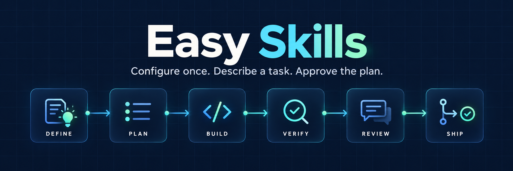
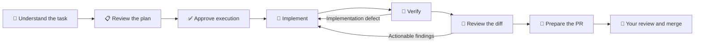

# Easy Skills



<p align="center">
  <a href="https://github.com/yahormarashchuk/Easy-Skills/actions/workflows/ci.yml"></a>
  <a href="package.json"></a>
  <a href="LICENSE"></a>
  <a href="docs/implementation-status.md"></a>
</p>

**Configure your project once. Describe a task. Discuss requirements with AI. Choose your models. Approve the plan. Easy Skills develops, tests, reviews, and prepares a Pull Request autonomously.**

A local CLI for developers who want to assign work, review a clear proposal, and
return to a reviewed PR. Uses official AI CLI authentication and keeps execution
state on your machine. No mandatory Docker, WSL, server, dashboard, or direct model
API key.

<p align="center">
  <a href="#quick-start">Quick start</a> ·
  <a href="#how-it-works">How it works</a> ·
  <a href="#commands">Commands</a> ·
  <a href="#models">Models</a> ·
  <a href="#documentation">Documentation</a>
</p>

> [!IMPORTANT]
> **Development alpha — `0.1.0-alpha.2`.** The guided journey is covered by local
> fixtures; live Codex/GitHub acceptance is still pending. Real Claude Code execution
> remains blocked until managed-hook isolation can be verified. No provider or model
> is silently substituted. Published alpha.1 assets predate this guided workflow.

## ✨ What you get

| | Capability | What it means for you |
| --- | --- | --- |
| 💬 | Project-aware conversations | Investigate existing code and conventions, then discuss unresolved questions. |
| 🧠 | Reusable project knowledge | Save approved rules, source references, and owner answers for future tasks. |
| 🎛️ | Exact model assignments | Choose a provider and exact model for each of six engineering stages. |
| 🔀 | One task, one PR | Reuse an existing Issue, work on one isolated branch, and deliver a PR for manual acceptance. |
| 🧪 | Checks and review | Run approved checks, review the actual diff, and repair defects within the approved limit. |
| 🔄 | Recoverable execution | Persist progress and exact sessions across interruptions, quota waits, and retries. |

<a name="quick-start"></a>

## 🚀 Quick start

### 1️⃣ Install and sign in

| Prerequisite | Purpose |
| --- | --- |
| Node.js **24+** | Runs the local Easy Skills CLI and SQLite state store. |
| Git | Creates isolated task worktrees and branches. |
| GitHub CLI (`gh`) | Reads Issues and publishes approved branches and PRs. |
| Official Codex CLI | Runs your selected exact models using official authentication. |

Sign in through the official tools:

```powershell
gh auth login
codex login
```

From this source checkout, build and install the current guided alpha:

```powershell
npm ci
npm run build
npm pack
npm install -g ./easy-skills-0.1.0-alpha.2.tgz
```

Package users install the compiled tarball; the package contains the runtime, skills,
schemas, templates, and documentation. There is no npm registry release for this
working version. See [installation, upgrades, and removal](docs/installation/README.md).

### 2️⃣ Configure your project once

Open the existing GitHub repository you want Easy Skills to work on. Its `origin`
must identify the intended repository. Run:

```powershell
easy-skills init
```

Easy Skills inventories maintained instructions, manifests, docs, skills, and code
examples. Choose an exact model profile, answer the unresolved questions, and review
the proposed rules, setup commands, and required checks before saving them.

Discovery does not execute project tests or change application code. Existing
instructions are preserved. Large projects start with bounded samples; deeper
inspection and instruction validation can take longer.

### 3️⃣ Assign a task

```powershell
easy-skills run 909
```

The AI reads the existing Issue and relevant implementation, discusses requirements,
and prepares a technical plan. Confirm the specification and model assignments, then
approve **Start autonomous development** once.

If project onboarding is missing, Easy Skills performs it and continues your task.
You do not need to prepare YAML or copy approval hashes for the normal terminal flow.

### 4️⃣ Follow progress and review the PR

```powershell
easy-skills status
```

The detached worker implements, checks, reviews, and publishes the approved work.
The result is a reviewed PR awaiting your acceptance. **Final merge is manual by
default.** Closing the terminal does not stop the detached worker.

> [!TIP]
> If PowerShell blocks an npm `.ps1` wrapper, use `easy-skills.cmd` or `npm.cmd` with
> the same arguments. No system execution-policy change is required. Native Windows
> and paths containing spaces are supported.

<a name="how-it-works"></a>

## 🛠️ How it works



| Step | Easy Skills does | You decide |
| --- | --- | --- |
| 👀 Discover | Read project conventions, examples, and existing instructions. | Resolve important gaps and approve project rules. |
| 💬 Define | Investigate the task, related code, tests, and skills. | Clarify behavior, acceptance, and exclusions. |
| 📋 Plan | Prepare a concrete implementation plan and display all six model assignments. | Approve the displayed scope, commands, and permissions. |
| 🔨 Develop | Work in an isolated branch, run checks, and perform a separate review. | Respond only to genuine blockers or material changes. |
| 🔀 Deliver | Push the approved branch and create or update its PR. | Review the result and choose when to merge. |

The execution approval covers the displayed task paths, setup and checks, repair
limit, branch push, and PR handling. Protected checks, rules, and exact assignments
remain enforced. Passing check evidence comes from executed commands at the reviewed
commit; model prose does not establish a passing test.

## 📥 Start from an Issue, an idea, or a specification

| Starting point | Example |
| --- | --- |
| Existing Issue | `easy-skills run 909` |
| Issue URL in the configured repository | `easy-skills run https://github.com/owner/repository/issues/909` |
| Natural-language task | `easy-skills run "Fix search by full name"` |
| Local Markdown or text specification | `easy-skills run "docs/specs/name search.md"` |

An existing Issue is reused and remains open until its reviewed PR is actually
merged. Text and local-document tasks create a PR without creating an Issue.
Direct PR delivery does not require branch-protection API access or automatic merge
eligibility, including in restricted private repositories.

To discuss a correction **before execution**, decline the proposal and refine the
same Issue:

```powershell
easy-skills run 909 --refine "Preserve selection behavior and normalize spaces"
```

<a name="models"></a>

## 🎛️ Choose your models

Save a named profile such as **Fast**, **Balanced**, or **High Quality**, using the
exact model IDs available in your official clients. These are your profile names;
Easy Skills does not invent provider-specific model IDs.

| Stage | Responsibility | Assignment |
| --- | --- | --- |
| DEFINE | Project and task interviews | Your exact provider/model pair |
| PLAN | Technical implementation planning | Your exact provider/model pair |
| BUILD | Implementation and corrective changes | Your exact provider/model pair |
| VERIFY | Acceptance inspection alongside runner-executed checks | Your exact provider/model pair |
| REVIEW | Separate review of the actual file diffs | Your exact provider/model pair |
| SHIP | Delivery-readiness inspection before runner publication | Your exact provider/model pair |

```powershell
easy-skills config
```

Saved profiles avoid re-entering all six assignments for each task. Availability,
authentication, and compatibility are checked. Compatibility probes request consent
before using account quota and validate exact-session continuation.

**Use an all-Codex profile for the initial pilot.** Claude Code assignments can be
saved, but real launches currently stop with an isolation diagnostic. Explicitly
choose another supported configuration when necessary; there is no silent fallback.

## 🔄 Resume work and request changes

| Situation | Command | Result |
| --- | --- | --- |
| Check the latest task | `easy-skills status` | Readable progress, PR, or genuine blocker. |
| Resume after interruption | `easy-skills resume` | Continue the approved plan and recorded sessions. |
| Revise an Issue's delivered work | `easy-skills revise 909 "Also normalize repeated spaces"` | Review a revised plan and update the same branch and PR. |
| Revise a text or document task | `easy-skills revise latest "Describe the correction"` | Select the latest active task without an internal ID. |
| Update project rules | `easy-skills rules "Require approval before new dependencies"` | Investigate conflicts and approve a new rules version. |

Feedback retains the previous specification and implementation context. A revised
approval invalidates old readiness, preserves approval history, and repeats checks
and review. A materially different plan cannot inherit old permission.

Quota and network waits use backoff. Authentication problems require official login.
A recorded live client blocks a duplicate executor. Changed, closed, merged, or
actively merging PRs require reconciliation before further changes.

<a name="commands"></a>

## ⌨️ Commands at a glance

| Command | Use it to… |
| --- | --- |
| `easy-skills init` | Learn a project and approve reusable rules. |
| `easy-skills run <task>` | Discuss requirements and start approved autonomous work. |
| `easy-skills status [task]` | Inspect the latest task or a selected Issue. |
| `easy-skills resume [task]` | Recover an approved task safely. |
| `easy-skills revise <task> "feedback"` | Update an existing PR; use `latest`, an Issue number, or a displayed task title. |
| `easy-skills rules ["change"]` | Review or update the project rules. |
| `easy-skills config` | Select or edit exact stage model profiles. |
| `easy-skills install-skills --client codex --interactive` | Install official packaged skills with reviewed backups. |

The terminal workflow works directly. Installing the optional client-discoverable
skills exposes Easy Skills procedures inside supported clients without relying on
another local repository. Unrelated user skills are preserved; replaced managed
files receive backups.

## 🗂️ What is saved?

| Location | Contents |
| --- | --- |
| `.easy-skills/rules/` | Approved project rules, including preserved existing rule files. |
| `.easy-skills/context/` | Project knowledge, source references, owner answers, and discovered skill paths. |
| `.easy-skills/project.yaml` and the rules agreement | Managed project settings and versioned approval bindings. No manual editing is required for the guided flow. |
| External Easy Skills state home | SQLite execution state, profiles, sessions, logs, recovery records, and approval history. |

The state home defaults to `%LOCALAPPDATA%/EasySkills` on Windows and
`~/.local/share/EasySkills` elsewhere. `EASY_SKILLS_HOME` can select another directory
outside the managed repository. Agents do not receive private runner logs or session
histories as task context.

Approved local knowledge travels in direct task plans, so a setup PR merge is
unnecessary. Changes to rules invalidate earlier execution approvals and require a
reviewed replacement.

## 🧭 Guided by default, advanced when needed

| Previous manual journey | Guided default |
| --- | --- |
| Prepare configuration and rules agreements by hand. | Investigate, discuss, and approve through `init`. |
| Operate draft, hash, approve, and start commands separately. | Review one execution proposal through `run`. |
| Use parent/task Issues and intermediate branches for a small fix. | Reuse the original Issue with one task branch and one PR. |
| Reconstruct context for a follow-up. | Use `revise` and keep the existing branch, PR, and history. |

Advanced `feature plan`, `feature draft`, `feature approve`, and `start` commands
remain available for dependent multi-task features with integration branches and
explicitly authorized intermediate merges. Automatic merges retain their strict
gates and separate reviewed-head authorization.

Use `status --json` for detailed diagnostics. Explicit scripted operation uses
`--non-interactive --answers FILE`; generated rule and execution approvals must
match the displayed proposal digest. Missing or stale consent stops.

Existing alpha.2 configuration and approved runs are preserved. Legacy approvals
without current reliability contracts need a separately reviewed replacement.
Do not upgrade the package while its workers are active.

<a name="documentation"></a>

## 📚 Documentation

| Guide | What you will find |
| --- | --- |
| [Installation](docs/installation/README.md) | Packaging, skill discovery, Windows wrappers, removal, and upgrades. |
| [Guided workflow and migration](docs/guided-workflow.md) | Storage, trust, scripted approvals, feedback, migration, and remaining limits. |
| [Implementation status](docs/implementation-status.md) | Implemented behavior and outstanding acceptance work. |
| [Advanced operations](docs/advanced-operations.md) | Explicit configuration and multi-task feature procedures. |
| [Runner architecture](docs/architecture/runner.md) | Durable execution, approvals, evidence, ownership, and recovery. |
| [Merge gates](docs/merge-gate.md) | Separate merge authorization and GitHub policy requirements. |
| [Provider compatibility](docs/provider-compatibility/README.md) | Actual provider observations and current restrictions. |
| [Validation](docs/validation.md) | Deterministic fixtures and separately authorized live checks. |
| [MCP](docs/mcp.md) / [Remote control](docs/remote-control.md) | Optional integrations and advanced control. |

## 🧰 Develop and verify

```powershell
npm ci
npm run check
npm test
npm run build
npm pack
```

Tests use temporary repositories, real local Git operations, and injected model,
GitHub, and notification fixtures. A fixture pass does not establish live-provider
or GitHub acceptance. Real model requests and external mutations require separate
explicit authorization.

Apache-2.0 · [License](LICENSE) · [Contributing](CONTRIBUTING.md) ·
[Procedure provenance](THIRD_PARTY_NOTICES.md)
